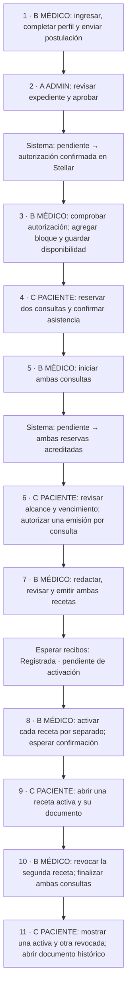

# Grabación · Tres navegadores, tres cuentas

> Nota de copia pública · 22-10-2026: Copia pública de continuidad: las cuentas identificables se sustituyeron por actores anónimos donde correspondía; no se alteraron recibos ni hashes.

Aplicación en los tres navegadores: https://trustleaf-demo.vercel.app

| Navegador o perfil independiente | Rol | Cuenta |
|---|---|---|
| A | Administrador | actor-admin@example.test |
| B | Médico nuevo | actor-medico-nuevo@example.test |
| C | Paciente | actor-paciente@example.test |

Tú haces todos los clics. El médico completa y envía su propio perfil; el administrador revisa y aprueba. No hay que crearle manualmente una wallet ni enviar una invitación. actor-medico-nuevo queda sin registrar hasta la grabación.

## Recordatorio al lado de la grabación

**Orden de ventanas: B → A → B → C → B → C → B → C → B → C.**

- Tres perfiles independientes, no sólo tres pestañas. Comprobar el correo del actor antes de actuar.
- Pausar para introducir códigos de Privy. No mostrar códigos ni secretos.
- Al configurar agenda: **Agregar bloque → Guardar disponibilidad**. Usar día y hora de Chile; reservar dos horas futuras próximas que permitan confirmar asistencia.
- **Asistencia no es consentimiento.** El consentimiento se concede después de acreditar la reserva.
- Una acción pendiente todavía no está confirmada. Esperar el recibo; no repetir la firma por una demora.
- Tras acreditar, hay **30 minutos para emitir**. Tener listas las sesiones antes de iniciar consultas.
- **Emitir no activa.** Mostrar el estado registrado antes de activar.
- Revocar conserva el historial. La segunda receta se activa primero y luego se revoca.
- Los IDs se conocen al emitir; no asumir números. No reutilizar las consultas consumidas de las recetas #7 y #8.
- El worker procesa automáticamente las solicitudes administrativas y de reserva; tú no debes usar terminal.

## Estado de preparación

El ensayo en main confirmó emisión, activación, revocación y lectura de ambos participantes. La auditoría independiente comprobó sus 12 recibos. La corrección PR #118 está desplegada.

**Todavía no se declara validación final completa:** faltan las solicitudes directas autenticadas de administrador/usuario ajeno a documentos y del paciente a una acción médica. La prueba sin sesión y el listado vacío del administrador no sustituyen esos controles. No registrar al médico nuevo para resolver estas comprobaciones; usar las cuentas del ensayo.

Después de grabar: auditar los recibos nuevos, incorporar el video y cerrar la PR documental #119. Sólo Stellar Testnet y datos sintéticos.
